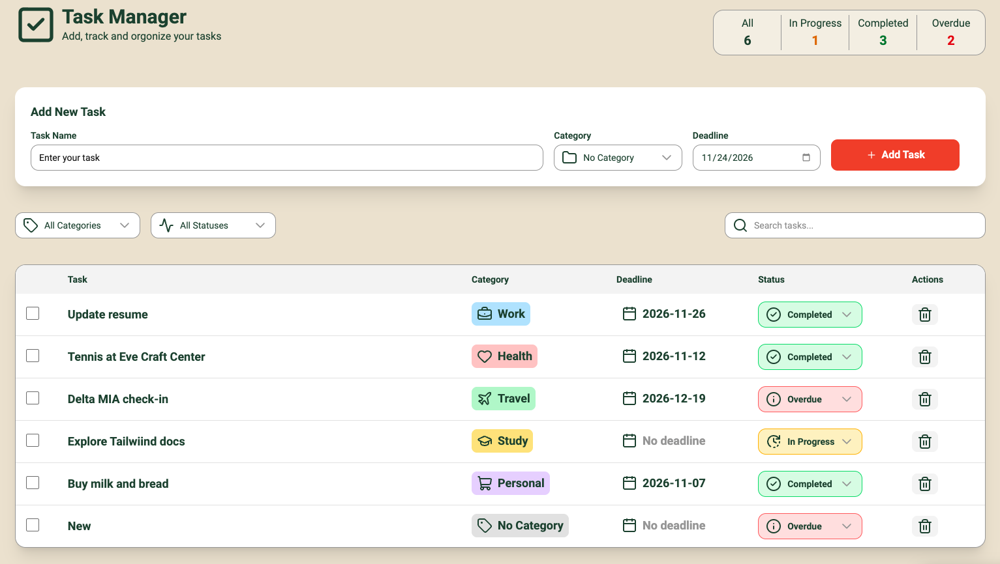

# Task Management App

## [Live Demo](https://dmitryulasau.github.io/SBA-4-task-management-app/)

### Reflection
I started by building the whole page in HTML with Tailwind, and that part went ok. The hard part came when I started JavaScript and had to create table rows dynamically. Every row has several SVG icons and building those with createElement meant creating each svg and use element and setting attributes one by one. It was long, hard to read, and painful. I switched to template literals, so I could write the row as HTML and put in values with ${}. It was much easier to read.

I didn't understand at first why closest() was needed. Clicking the icon inside a button doesn't give me the button as `e.target`.

When I added localStorage, I realized I needed a tasks array as the source, with the table drawn from it.

I guess is a normal part of development: reading documentation, searching for solutions, and asking AI to explain an error or review my code. The important part is that I don't just copy the answer. I make sure I try to understand why it works, then adjust it to my own code.

Small bugs that were hard to spot. One of them was a copy-paste mistake where I wrote progress += 1 in all three branches, so the board numbers were wrong.

I broke the work into small steps and tested each one in the browser before moving on. I used `console.log` and DevTools to see what was really happening.

What I would improve if given more time:

- Build the "Edit button", which is in the layout but hidden right now.
- Set "Overdue" automatically by comparing the deadline with today's date, instead of choosing it by hand.
- Split app.js into smaller files so it's easier to maintain.

### Questions?

[Dmitry Ulasau](https://github.com/dmitryulasau)
